<div align="center">


# GreenMind - Symbiotic Growth Initiative

**Environmental and Personal Growth-Oriented Web Application for a CSR Initiative**

*Grow Ethically, Plant Sustainably* 🌱

[](https://youtu.be/HGnvS5JjY3E)
[](https://bhavika-giyanani.github.io/Portfolio/greenmind.html)


</div>

---

## 📺 Demo

[](https://youtu.be/HGnvS5JjY3E)

> Click the thumbnail to watch the full walkthrough on YouTube.

---

## 📖 About the Project

**GreenMind** is a team project focused on the **ethical and academic growth of children** while **promoting environmental sustainability**.

Children grow themselves through three daily activities: reading and reflecting, focusing, and meditating. Each activity earns a natural resource (**water 💧, sunlight ☀️ and soil 🌍**), and together these resources grow a virtual tree. A friendly panda guide, **Zen 🐼**, supports them along the way.

> 🌳 **Upon completing five levels, the CSR team plants a real tree on behalf of the user**, reinforcing the application's commitment to environmental growth.

---

## ✨ Key Features

| Feature | What it does | Reward |
|---|---|---|
| 📚 **Self-Growth Area** | Offers cleansing content for ethical development, followed by quizzes | 💧 **Water points** for correct answers |
| ⏱️ **Pomodoro Timer** | Implements the Pomodoro Technique to enhance productivity, with 25-minute work intervals followed by 5-minute breaks | ☀️ **Sunlight points** |
| 🧘 **Meditation Spot** | Provides meditation resources to foster a connection with humanity | 🌍 **Soil points** |
| 🌱 **Progress Tracker** | Displays the current level and shows a tree animation that converts a sapling into a tree as the user progresses, along with rain animation and Zen guidance from a cute panda character | Level-ups and real tree planting |

---

## 🖼️ Screenshots

### Splash and Onboarding

<table>
  <tr>
    <td align="center" width="50%">
      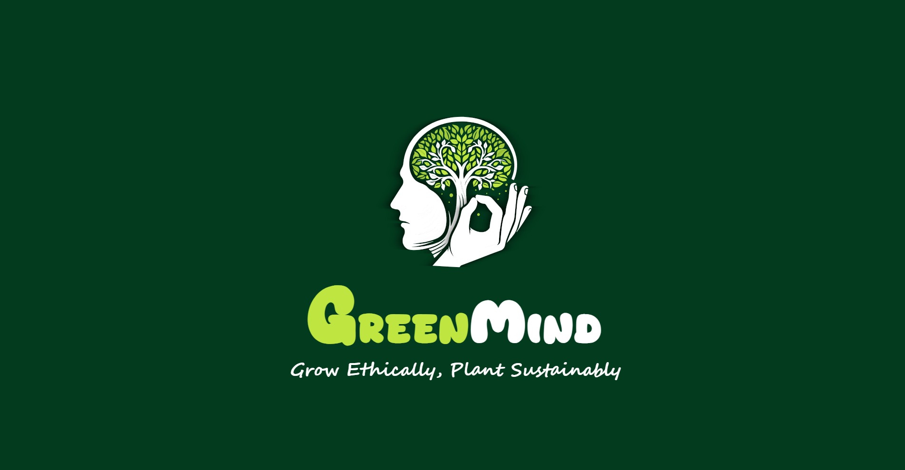<br/>
      <b>Splash Screen</b>
    </td>
    <td align="center">
      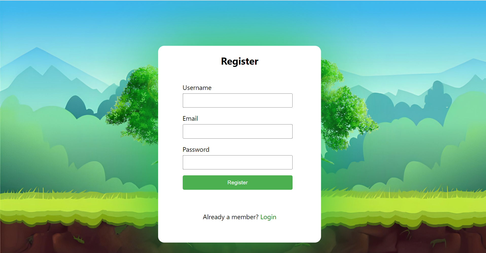<br/>
      <b>Register</b>
    </td>
  </tr>
</table>

### 🌱 Progress Tracker (Home Screen)

<table>
  <tr>
    <td align="center" width="50%">
      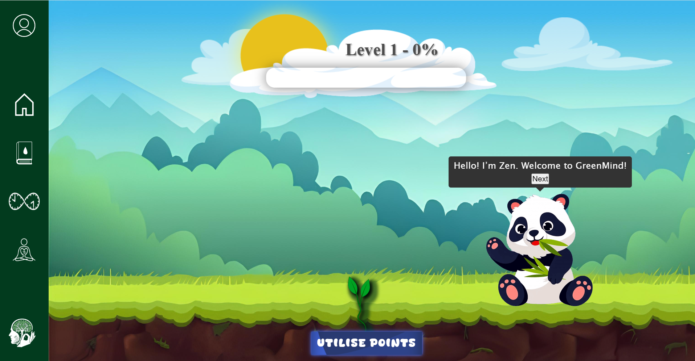<br/>
      <b>Progress Tracker (Home Screen)</b>
    </td>
    <td align="center" width="50%">
      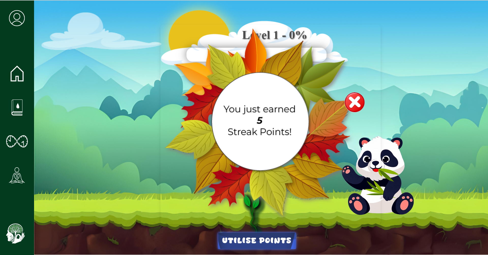<br/>
      <b>Daily Streak Pop-up</b>
    </td>
  </tr>
  <tr>
    <td align="center">
      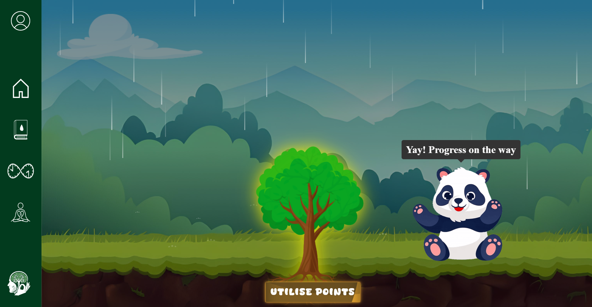<br/>
      <b>Level Completion Animation</b>
    </td>
    <td align="center">
      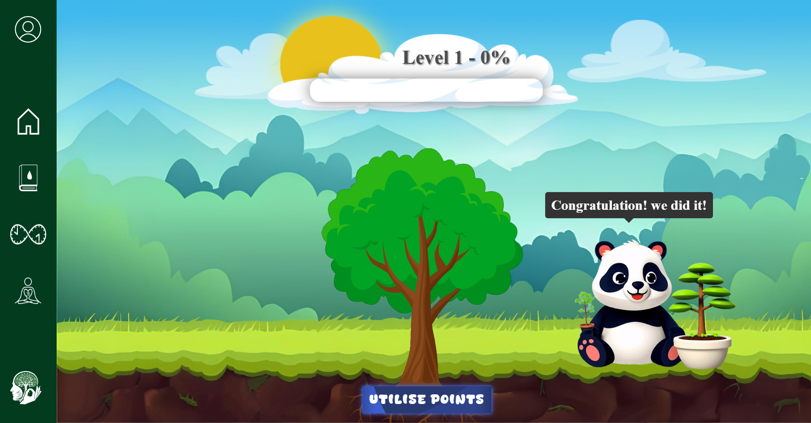<br/>
      <b>Tree Growth Achievement Animation</b>
    </td>
  </tr>
  <tr>
    <td align="center" colspan="2">
      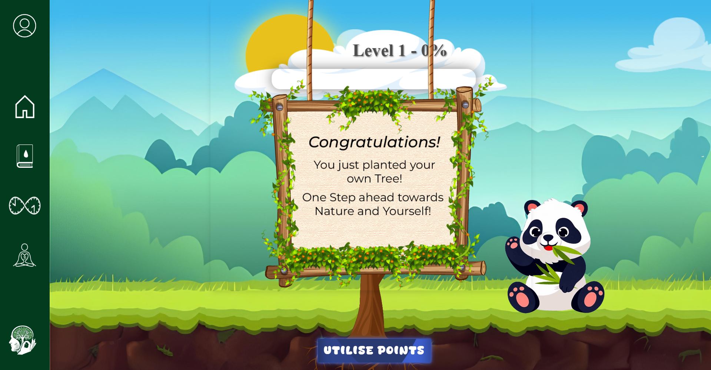<br/>
      <b>Tree Growth Achievement Pop-up</b>
    </td>
  </tr>
</table>

### 📚 Self-Growth Area

<table>
  <tr>
    <td align="center" width="50%">
      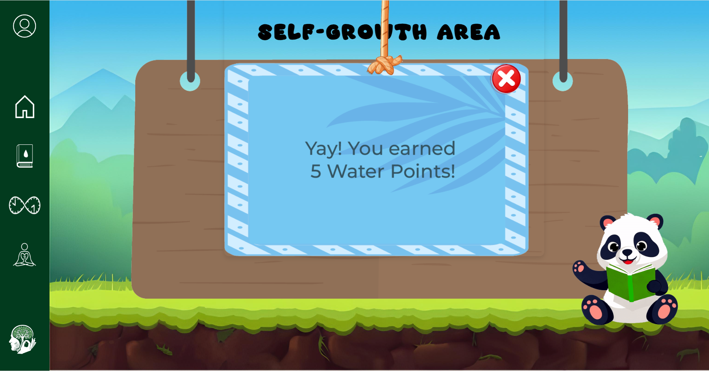<br/>
      <b>Self-growth Area (Zen Pop-up)</b>
    </td>
    <td align="center" width="50%">
      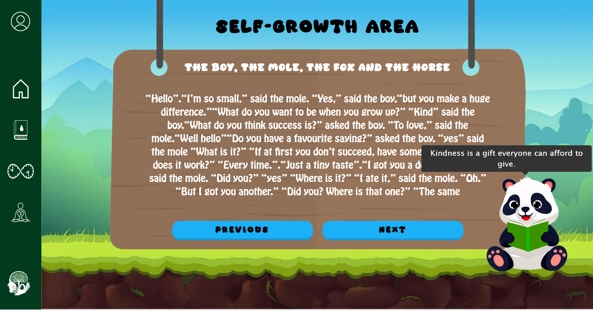<br/>
      <b>Self-growth Area (Content Reading Task)</b>
    </td>
  </tr>
  <tr>
    <td align="center">
      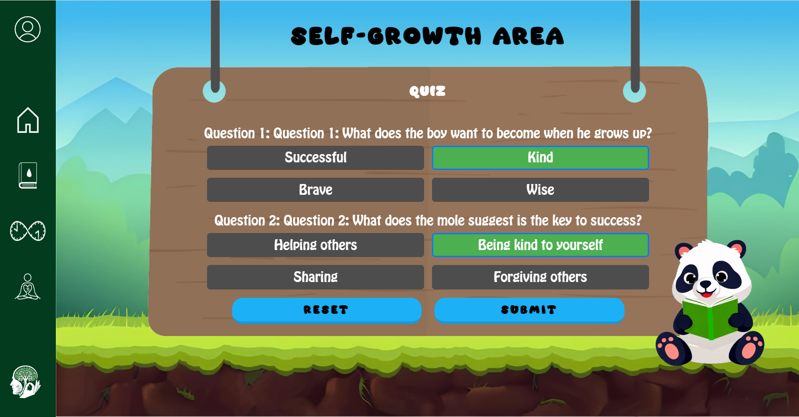<br/>
      <b>Self-growth Area (Quiz - Correct Answer)</b>
    </td>
    <td align="center">
      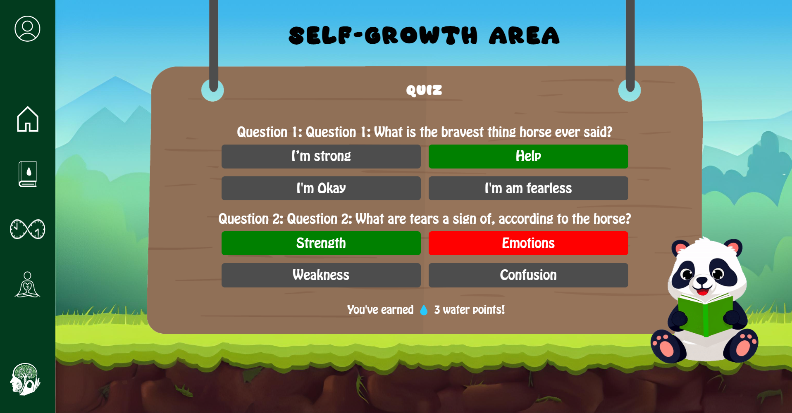<br/>
      <b>Self-growth Area (Quiz - Incorrect Answer)</b>
    </td>
  </tr>
</table>

### ⏱️ Pomodoro Timer

<table>
  <tr>
    <td align="center" width="50%">
      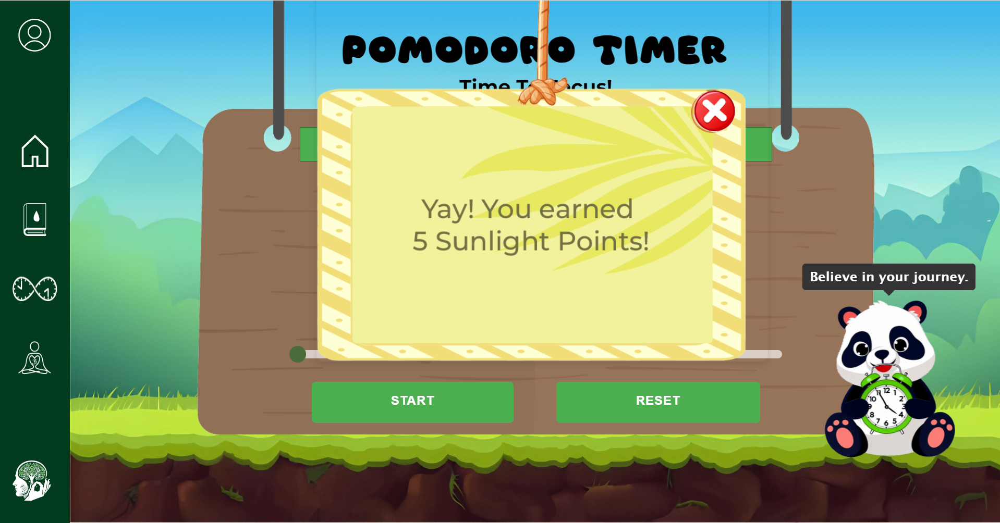<br/>
      <b>Pomodoro (Zen Pop-up)</b>
    </td>
    <td align="center" width="50%">
      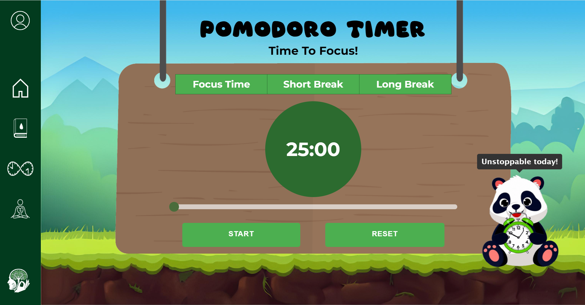<br/>
      <b>Pomodoro Timer</b>
    </td>
  </tr>
</table>

### 🧘 Meditation Spot

<table>
  <tr>
    <td align="center" width="33%">
      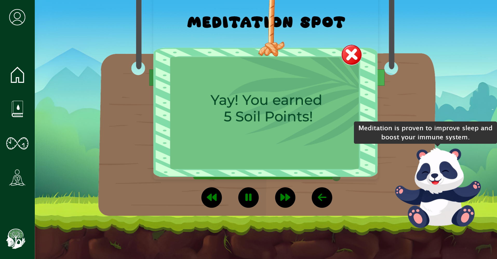<br/>
      <b>Meditation (Zen Pop-up)</b>
    </td>
    <td align="center" width="33%">
      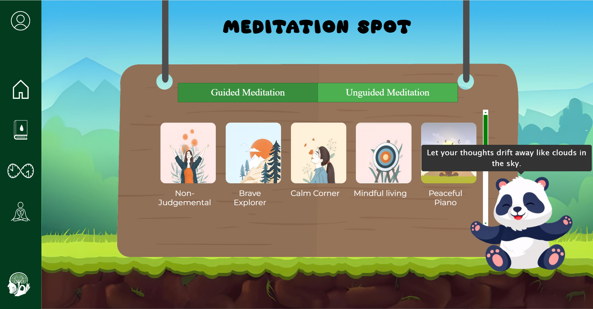<br/>
      <b>Meditation Spot</b>
    </td>
    <td align="center" width="33%">
      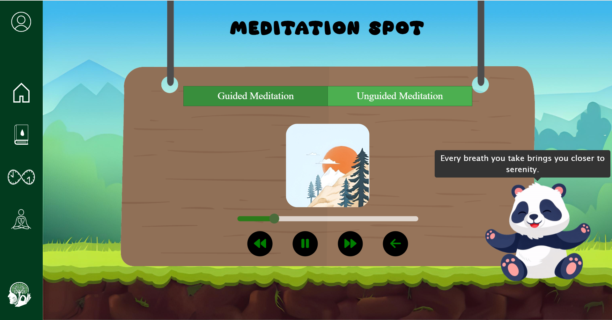<br/>
      <b>Meditation Player</b>
    </td>
  </tr>
</table>

### 👤 Profile

<p align="center">
  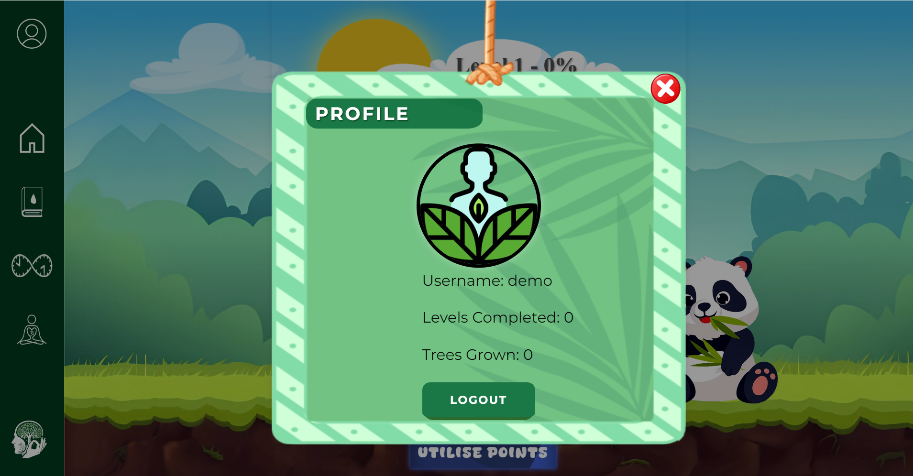<br/>
  <b>Profile</b>
</p>

---

## 🎮 How It Works

### Earning Points

| Activity | How to earn | Reward |
|---|---|---|
| 🔑 **Daily Login Streak** | Log in on consecutive days | **+5** per consecutive day, **+10** on the 7th day |
| 📚 **Self-Growth Area** | Read the day's content, then answer the 2-question quiz | 💧 **+5 water** (2 correct) or **+3 water** (1 correct) |
| ⏱️ **Pomodoro Timer** | Complete a focus session | ☀️ **+5 sunlight** (once per day) |
| 🧘 **Meditation Spot** | Listen to a meditation track until it ends | 🌍 **+5 soil** (once per day) |

### Levelling Up

Total points (water + sunlight + soil + streak points) fill the level bar on the home screen. Each level needs more points than the last:

| Level | Points needed | Tree stage |
|:---:|:---:|:---:|
| 1 | 20 | 🌱 Stage 1 |
| 2 | 40 | Stage 2 |
| 3 | 80 | Stage 3 |
| 4 | 120 | Stage 4 |
| 5 | 160 | 🌳 Stage 5 |

> Completing all five levels (**420 points in total**) triggers the **Tree Growth Achievement** animation and pop-up, adds a tree to the user's **Trees Grown** count, and resets the progress so the journey can begin again. This is the moment the CSR team plants a real tree on the user's behalf.

---

## 🐼 Meet Zen

**Zen** is GreenMind's panda guide, designed to make the experience warm and encouraging for children. Zen appears throughout the app with their own animations and pop-ups:

- 👋 **Greets** the user on arrival and walks them through the app
- 📖 **Guides** the reading task in the Self-Growth Area
- ⏱️ **Motivates** during the Pomodoro focus sessions
- 🧘 **Calms** the user at the Meditation Spot
- 🏆 **Celebrates** achievements with a dance and tree-growth pop-ups

---

## 🛠️ Tech Stack

| Layer | Technologies |
|---|---|
| **Frontend** | HTML5, CSS3, JavaScript, jQuery, Tippy.js / Popper (Zen tooltips) |
| **Backend** | Node.js, Express.js |
| **Database** | MongoDB with Mongoose |
| **Real-time** | WebSocket (`ws`) for live points, level and profile sync |
| **Validation and Middleware** | express-validator, body-parser, cors |
| **Design and Animation** | Adobe Illustrator, Adobe Photoshop, CSS animations |

---

## 📁 Project Structure

```
GreenMind/
├── app.js                    # Express server, MongoDB models, REST APIs & WebSocket server
├── SelfGrowthContent.json    # Self-growth stories and quizzes (seed data)
├── package.json
├── assets/                   # README images (logo & screenshots)
└── public/
    ├── splash.html           # Splash screen
    ├── login.html            # Login
    ├── register.html         # Registration
    ├── forgot_password.html  # Change / reset password
    ├── progress_tracker.html # Home screen: level bar, tree, rain & Zen
    ├── selfGrowth.html       # Self-Growth Area: reading task + quiz
    ├── pomo.html             # Pomodoro Timer
    ├── meditate.html         # Meditation Spot
    ├── profile.html          # User profile
    ├── ProgressTracker/      # Tree stages, rain, clouds and level logic
    ├── SelfGrowth/           # Reading & quiz logic
    ├── Pomodoro/             # Timer logic and bell sound
    ├── MeditationSpot/       # Guided and unguided audio and covers
    ├── ZenGreet/             # Zen greeting, dance and achievement animations
    ├── Profile/              # Profile page assets and logic
    └── imgs/                 # Shared images (background, trees, nav icons)
```

---

## 🚀 Getting Started

### Prerequisites

- [Node.js](https://nodejs.org/) (v16 or later recommended)
- [MongoDB](https://www.mongodb.com/try/download/community) running locally on the default port `27017`

### Installation

1. **Clone the repository**
   ```bash
   git clone https://github.com/Bhavika-Giyanani/GreenMind.git
   cd GreenMind
   ```

2. **Install dependencies**
   ```bash
   npm install
   ```

3. **Start MongoDB**, then load the Self-Growth content into the `GreenMind` database:
   ```bash
   mongoimport --db GreenMind --collection Content --file SelfGrowthContent.json --jsonArray
   ```

4. **Run the server**
   ```bash
   node app.js
   # or, for auto-reload during development:
   npx nodemon app.js
   ```

5. **Open the app** at **http://localhost:3000**

| Service | Address |
|---|---|
| Web app and REST API | `http://localhost:3000` |
| WebSocket server | `ws://localhost:8081` |
| MongoDB | `mongodb://localhost:27017/GreenMind` |

---

## 🔌 API Overview

| Method | Endpoint | Description |
|---|---|---|
| `POST` | `/submit` | Register a new user (with validation) |
| `POST` | `/login` | Log in and update the daily streak |
| `POST` | `/change_password` | Change a user's password |
| `GET` | `/api/content` | Fetch Self-Growth stories and quizzes |
| `GET` | `/api/users/:username` | Fetch a user's water points |
| `PATCH` | `/api/users` | Award water points after the quiz |
| `PATCH` | `/update_sunlight_points` | Award sunlight points (Pomodoro) |
| `PATCH` | `/update_soil_points` | Award soil points (Meditation) |
| `PATCH` | `/api/updateDaily` | Save the daily Self-Growth progress |
| `GET` | `/getDaily/:username` | Fetch the daily Self-Growth progress |

**WebSocket (`ws://localhost:8081`)** keeps the points, levels, trees grown and progress in sync, and handles profile image updates.

---

## 👩‍💻 My Contributions

> GreenMind was built as a team project. My contributions:

- 💡 **Project idea**
- 🎨 **Logo** design
- ✨ **Splash screen** designing and animation
- 🖥️ Some portion of the **website design** and the **Progress Tracker**
- 📚 **Self-Growth Area**: both frontend and backend
- 🐼 **Zen (Panda character)** designing and animations
- 💬 **Zen pop-ups**
- 🎬 **All animation work** for the website (excluding the login/register animations), including the **navbar, board, cloud, rain and tree growth animations**

---

## 🌍 CSR Impact

GreenMind connects a child's daily habits to real environmental action. Every five levels completed by a user result in a real tree planted by the CSR team in their name, so personal growth leads directly to environmental growth.

---


<div align="center">

*Grow Ethically, Plant Sustainably* 🌳

</div>
